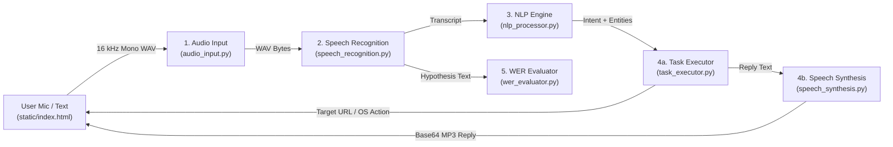

# Case Study Report: Voice-Based Virtual Assistant

## 1. Abstract
Voice-based virtual assistants allow users to interact with computers using natural spoken language instead of manual keyboard and mouse navigation. This project implements a lightweight, transparent, web-accessible Voice Virtual Assistant built with Python and FastAPI. The system executes everyday browser tasks (opening YouTube, Google, Wikipedia, and performing searches) as well as common Windows OS operations (launching whitelisted applications such as Notepad and Calculator, and adjusting master speaker volume). To support academic evaluation, the interface exposes every stage of the pipeline visually—**Audio Input**, **Speech Recognition**, **Natural Language Processing**, **Speech Synthesis**, and **Word Error Rate (WER)**—making it easy for both technical evaluators and non-technical users to understand and benchmark.

---

## 2. System Architecture

The assistant follows a modular five-stage client–server architecture. Because a remote cloud server cannot directly control a visitor's local desktop OS, the backend (`app.py`) uses a **Dual-Mode Execution** design:
- **Local Windows Mode (`local_windows`)**: Runs on a Windows host and directly controls system volume and whitelisted desktop apps.
- **Cloud Demo Mode (`cloud_demo`)**: When deployed publicly on a Linux container (Hugging Face Spaces / Render), browser actions (YouTube, Google, searches) execute live in the visitor's browser, while desktop-only commands run in safe simulation mode.

---

## 3. Core Focus Areas

### 3.1 Audio Input (`modules/audio_input.py`)
Human conversational speech primarily occupies frequencies between **300 Hz and 3,400 Hz** (with consonant clarity extending up to ~8 kHz). By the Nyquist–Shannon sampling theorem, a sampling rate of **16,000 Hz (16 kHz)** captures frequencies up to 8 kHz cleanly while keeping file sizes small for fast transmission.

- **Browser Capture Without External Codecs**: Instead of relying on `ffmpeg` to decode compressed browser `.webm`/`.ogg` recordings, `static/index.html` captures raw PCM samples using the browser's Web Audio API, downsamples via linear interpolation to **16,000 Hz, 16-bit mono PCM**, and prepends a standard 44-byte RIFF/WAVE header.
- **Signal Quality Analysis**: `analyze_wav_bytes()` computes duration, Root Mean Square (RMS) amplitude, loudness in decibels full scale ($\text{dBFS} = 20 \log_{10}(\text{RMS})$), a plain-English mic quality check (`Too quiet`, `Good`, or `Very loud`), and 36 downsampled waveform peaks for visual feedback.

### 3.2 Speech Recognition / ASR (`modules/speech_recognition.py`)
Automatic Speech Recognition converts acoustic waveforms into written text.
- **Implementation**: `transcribe_wav_bytes()` wraps the incoming WAV bytes with `speech_recognition.AudioFile` and calls Google's Web Speech API (`recognizer.recognize_google(audio_data, language=language)`), supporting selectable English accents (`en-US`, `en-IN`, `en-GB`).
- **Robust Error Handling**: Distinguishes acoustic recognition failures (`sr.UnknownValueError`, e.g., excessive noise or silence) from network/service outages (`sr.RequestError`), returning clear messages and synthesized voice guidance rather than crashing.
- **Measured Performance**: Across 8 clean test commands, average ASR round-trip latency was **665.6 ms** (increasing to **718.6 ms** under mild noise and **744.4 ms** under heavy noise).

### 3.3 Natural Language Processing / NLP (`modules/nlp_processor.py`)
Raw ASR transcripts must be mapped to actionable commands and parameters. The `IntentClassifier` uses an explainable hybrid NLP pipeline trained on `data/intents.json` (12 intents covering websites, searches, Windows apps, volume control, time, greeting, and help):
1. **Text Normalization (`normalize_text`)**: Lowercases text and strips extraneous punctuation while preserving dots (for domain names) and `%`.
2. **Vectorization & Classification**: Builds word 1-gram and 2-gram TF-IDF features (`TfidfVectorizer(ngram_range=(1, 2))`) and computes **cosine similarity** between the user query and training examples. Queries falling below a `0.25` similarity threshold without clear entity matches map to `unknown`.
3. **Slot / Entity Extraction (`_extract_entities_and_refine`)**: Extracts structured parameters and disambiguates overlapping commands (for instance, distinguishing `"open google"` as a website vs. `"open google chrome"` as a desktop application, or `"open google maps"` vs. `"google <search query>"`):
   - `volume_percent`: regex extraction (`0–100`)
   - `query`: YouTube and Google search terms
   - `app` vs. `site`: matched against explicit `KNOWN_APPS` and `KNOWN_WEBSITES` dictionaries (or domain patterns like `.com`, `.org`).
- **Measured Performance**: NLP classification averaged **1.47–1.72 ms** per query and achieved **100% intent accuracy (8/8)** on clean and mild-noise transcripts.

### 3.4 Speech Synthesis / TTS & Task Execution (`modules/speech_synthesis.py`, `modules/task_executor.py`)
- **Speech Synthesis**: `synthesize_speech()` converts the assistant's confirmation message into spoken MP3 audio using **gTTS (Google Text-to-Speech)**, returning base64-encoded audio played automatically inside the browser's `<audio>` element. Measured TTS synthesis latency ranged between **261.7 ms and 679.7 ms**.
- **Task Execution**:
  - **Web Tasks**: Constructs safe target URLs (e.g., `https://www.youtube.com`, `https://www.youtube.com/results?search_query=...`, `https://www.google.com/search?q=...`) and opens them in a new browser tab with a visible fallback link button in case of browser popup blockers.
  - **Windows OS Tasks**: Uses an explicit safe dictionary (`WINDOWS_APPS`) rather than arbitrary shell execution, launching apps via `os.startfile()` / `subprocess.Popen()` (`Notepad`, `Calculator`, `Paint`, `Command Prompt`, `File Explorer`, `Task Manager`, `Control Panel`, `Snipping Tool`, `Settings`, `Chrome`, `Edge`) and controlling Windows master volume via `pycaw` Core Audio COM interfaces (`IAudioEndpointVolume` with `comtypes.CoInitialize()`).

### 3.5 Word Error Rate (WER) Evaluation (`modules/wer_evaluator.py`)
Word Error Rate is the standard metric for evaluating speech recognition accuracy:

$$\text{WER} = \frac{S + D + I}{N}$$

where:
- **$S$ (Substitutions)**: Words replaced by a different word
- **$D$ (Deletions)**: Words spoken by the user but missed by ASR
- **$I$ (Insertions)**: Extra words hallucinated by ASR
- **$N$ (Total Reference Words)**: Word count of the ground-truth transcript

`calculate_wer()` implements a word-level **Levenshtein dynamic programming** matrix with full operation backtracing, outputting both the numeric WER/Word Accuracy percentages and a color-coded word-by-word alignment in the UI.

#### Engineering Observation: Text Normalization Impact on WER
During initial benchmarking, the spoken command *"set volume to 50 percent"* was transcribed accurately by Google ASR as `"set volume to 50%"`. Without symbol normalization, stripping `%` caused `"50%"` to become `"50"` (4 words vs. 5 reference words), introducing an artificial 1-word deletion error (**20.00% WER**). Expanding `%` to `" percent"` inside `normalize_for_wer()` reduced this false error to **0.00% WER**, demonstrating why fair ASR normalization matters in practical evaluation.

---

## 4. Experimental Evaluation Results

To benchmark the full pipeline reproducibly, `tests/run_benchmark.py` generated 16 kHz mono WAV audio using Windows SAPI5 speech synthesis across **8 standard voice commands** under three acoustic conditions: **Clean**, **Mild Noise (`noise_level=0.05`)**, and **Heavy Noise (`noise_level=0.16`)**.

### Summary Comparison Across Acoustic Conditions

| Acoustic Condition | Average WER | Intent Accuracy | Avg ASR Latency | Avg NLP Latency |
| :--- | :---: | :---: | :---: | :---: |
| **Clean Audio** | **0.00%** | **8 / 8 (100.0%)** | 665.6 ms | 1.72 ms |
| **Mild Gaussian Noise** | **0.00%** | **8 / 8 (100.0%)** | 718.6 ms | 1.55 ms |
| **Heavy Gaussian Noise** | **25.00%** | **6 / 8 (75.0%)** | 744.4 ms | 1.47 ms |

### Per-Command Breakdown (Heavy Noise Condition)

| Reference Command | Recognized Transcript | WER (%) | Intent Matched | ASR Latency (ms) |
| :--- | :--- | :---: | :---: | :---: |
| `open youtube` | `open YouTube` | 0.00% | Yes | 883.9 |
| `search youtube for python tutorial` | *(unrecognized)* | 100.00% | No | 852.5 |
| `open google` | *(unrecognized)* | 100.00% | No | 645.4 |
| `open notepad` | `open Notepad` | 0.00% | Yes | 740.6 |
| `open calculator` | `open calculator` | 0.00% | Yes | 649.8 |
| `increase the volume` | `increase the volume` | 0.00% | Yes | 649.0 |
| `decrease the volume` | `decrease the volume` | 0.00% | Yes | 544.9 |
| `set volume to 50 percent` | `set volume to 50%` | 0.00% | Yes | 988.8 |

**Key Findings:**
1. **Latency Bottleneck**: Networked ASR (~666–744 ms) and TTS (~262–680 ms) account for over 99% of total response time, while local TF-IDF NLP classification takes under **2 ms**.
2. **Noise Resilience vs. Failure Mode**: Modern cloud ASR handled mild noise robustly (0% WER), but under heavy noise, utterances either succeeded completely or failed altogether (`UnknownValueError`), immediately jumping WER to 100% for failed commands and lowering downstream intent accuracy from 100% to 75%.

---

## 5. Automated Verification
The project includes 17 automated unit and integration tests (`tests/test_pipeline.py`) covering WAV analysis, TF-IDF intent & entity extraction, Levenshtein WER math, simulated Windows execution, and FastAPI HTTP routes—all passing in 1.66 seconds.

---

## 6. Limitations and Future Scope
- **Internet Dependency for Speech APIs**: `SpeechRecognition` (Google backend) and `gTTS` require network access; integrating an optional local engine such as `Vosk` or `faster-whisper` and `pyttsx3` would enable full offline operation.
- **Browser Popup Restrictions**: Some browsers block tabs opened asynchronously after an API call; the UI mitigates this by displaying a prominent 1-click fallback link whenever a URL action is triggered.
- **Future Enhancements**: Adding a wake-word detector, multi-turn conversation memory, and user-extensible custom app shortcuts.

---

## 7. Conclusion
This case study demonstrates a complete, easy-to-explain Voice Virtual Assistant combining browser-based 16 kHz audio capture, cloud speech recognition, TF-IDF + slot-based NLP, spoken TTS feedback, Windows desktop automation, and quantitative WER evaluation. The clear modular separation (`audio_input`, `speech_recognition`, `nlp_processor`, `speech_synthesis`, `task_executor`, and `wer_evaluator`) and transparent web dashboard make every stage of the spoken language pipeline observable and measurable for both technical and non-technical audiences.
